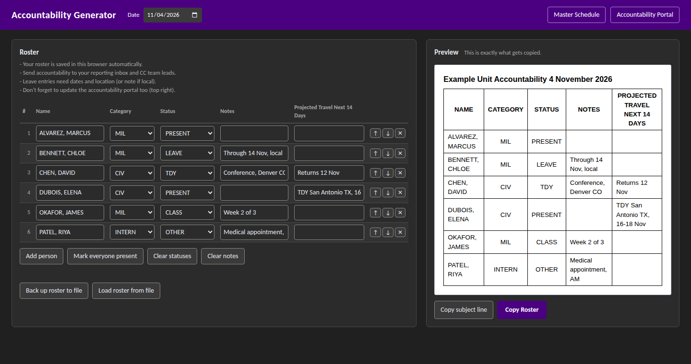

# Accountability Generator

Offline, single-file web tool that generates a standardized daily personnel accountability report for email, with quick links to related scheduling and accountability systems. Built for military and DoD units.



> **Note:** This is a sanitized version of a tool built by myself with the use of AI, and the original is used in production by a military staff. Organization names, internal links, email addresses and personnel data have been removed or replaced with fictional examples.


## The problem

Daily accountability (who is present, on leave, on travel, in training) was sent up to the front office by whoever was on duty that day. Coming from different military branches and units, each sender used a different format, different abbreviations, and different column orders, so the report reached senior leadership different every time. Leadership asked for one consistent format regardless of who sent it.

The constraints (being on government computers) :

- **No installs, no servers.** It had to run on locked-down government workstations.
- **Email is the delivery channel.** The output had to paste cleanly into Outlook.
- **Usable by anyone on the team** Any servicemember would need to be able to utilize the tool effectively.


## The solution

One HTML file that can open in any browser, works fully offline, can both download & allow uploading information, & standardizes the presentation format.

- **Controlled vocabulary.** Category and status come from drop-down lists, so abbreviations can't drift between senders.
- **One-click copy.** "Copy Roster" puts a formatted table on the clipboard as HTML, with a plain-text fallback, so it pastes into Outlook as a real table, not as text or an image.
- **Standardized subject line.** The subject and the email's title line are generated from the selected date (e.g. `Example_Unit Accountability 4 November 2026`).
- **Live preview.** The right-hand pane shows exactly what will be pasted.
- **Persistent roster.** The roster is saved in the browser (`localStorage`), so day to day you only change statuses. A JSON backup and restore lets the whole team share one roster file as needed.
- **Input validation.** Rows with a name but a missing category or status are flagged and alert.
- **Quick links.** Configurable banner buttons open related systems (schedule, accountability portal).


## Try it

1. Download or clone the repo.
2. Open `index.html` in Chrome or Edge.
3. Click **Load roster from file** and choose `examples/sample-roster.json`. (Optional - can just fill in information as desired)
4. Click **Copy Roster**, then paste into a new email or document.

The **Master Schedule** and **Accountability Portal** buttons open the bundled example pages in `examples/`. These are stand-ins for the real internal systems used in the orginal product and contain only fictional data.


## Configuration

Everything organization-specific lives in one block at the top of `index.html`:

```js
window.APP_CONFIG = {
  appTitle: "Accountability Generator",
  subjectPrefix: "Example_Unit Accountability",
  categories: ["MIL", "CIV", "INTERN"],
  statuses: ["PRESENT", "TDY", "CLASS", "LEAVE", "CONV LEAVE", "OTHER"],
  defaultStatus: "PRESENT",
  travelColumnLabel: "Projected Travel Next 14 Days",
  hints: [ /* reminders shown under the roster */ ],
  links: [
    { label: "Master Schedule",       url: "examples/master-schedule.html" },
    { label: "Accountability Portal", url: "examples/accountability-portal.html" }
  ],
  storageKey: "accountability:v1",
  exportFileName: "accountability_roster_export.json"
};
```

To adapt it for another team/unit, make edits in this ^ block and point `links` to real unit-specific URLs. No other code changes are needed throughout the body.


## Design decisions

- **Why HTML instead of interactive email?** Outlook (& other email clients) strips form controls and don't run scripts, so drop-downs can't live inside the email being generated. This tool creates the input, and the email receives only the finished table.
- **Why HTML on the clipboard?** Writing `text/html` (with `text/plain` as a fallback) makes Outlook paste a real, editable table. If the Clipboard API is blocked, as is standard on many DoD & Federal systems, the tool falls back to a selection-based copy.
- **Why is the pasted table colorless?** Outlook's dark mode recolors email content on the reader's side. A colored header designed for the original unit looked correct on the sender's side but would show up washed out to the recipients if they had dark-mode readers active. A colourless table reads the same in light and dark mode. If your organization only uses light mode, then color can be added back in, generally. 
- **Why `localStorage` plus JSON backup?** `localStorage` is per-browser and can be cleared by policy objects. The JSON export gives a portable backup and lets several people load the same roster.
- **Why one file?** It can be safely and reliably emailed, dropped on a shared drive, or opened from a desktop without dependencies, which is what made it deployable on managed workstations.


## Project structure

```
index.html                         The generator (configuration block at the top)
examples/master-schedule.html      Example stand-in for a team calendar
examples/accountability-portal.html  Example stand-in for an external check-in system
examples/sample-roster.json        Fictional roster for demos
docs/screenshot.png                README screenshot
```


## Tech

HTML, CSS and vanilla JavaScript, with no frameworks, build step or network access. Uses the Clipboard API, `localStorage`, `FileReader`/`Blob` for import and export, and CSS custom properties with `prefers-color-scheme` for light and dark themes (found to be unreliable for government systems, again, will depend on your organization). 


## Development notes

Built iteratively from stakeholder feedback, including a standardized subject line, removing of redundant or undesired columns, and addition of a 14-day travel column required by the front office for pre-emptive tracking. 
Developed with AI assistance (Claude, Opus 5.5) and customized/edited by hand.


## License

MIT. See LICENSE file.
